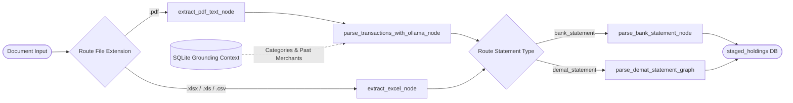

# 🚀 Personal Finance AI Assistant — Full Architecture & Operational Guide

## 1. Overview
The **Personal Finance AI Assistant** is an autonomous, privacy-first local financial platform. It ingests bank statements (PDFs), Demat tradebooks (PDFs), and daily Google Drive Excel ledgers (`MonthlyLedger.xlsx`), parses them with local Ollama LLMs grounded by your SQLite database, verifies transactions in a human-in-the-loop review area, and displays real-time financial health dashboards and AI Copilot advice.

---

## 2. Configuration & `.env` File
All runtime configurations, model names, and file paths are centralized in `backend/.env`:

```ini
# Application Settings
APP_NAME="Finance AI Assistant"
PORT=8000
HOST="0.0.0.0"

# Database Configuration
DATABASE_URL="sqlite:///D:/Work/ai_finance_assistant/finance.db"

# Local Ollama Models (Running on your RTX 3050 GPU)
OLLAMA_BASE_URL="http://localhost:11434"
OLLAMA_MODEL="gemma2:2b"
OLLAMA_COPILOT_MODEL="llama3.2"

# Ingestion Paths
FINANCIAL_STATEMENTS_DIR="D:/Work/ai_finance_assistant/FinancialStatements"
GOOGLE_DRIVE_LEDGER_PATH="G:/My Drive/MonthlyLedger.xlsx"

# User Defaults
DEFAULT_USER_EMAIL="user@local.finance"
DEFAULT_USER_NAME="Primary Investor"
DEFAULT_MONTHLY_SALARY=100000.00
DEFAULT_BASE_CURRENCY="INR"

# Background Sync Workers
MARKET_SYNC_ENABLED=true
MARKET_SYNC_INTERVAL_SECONDS=900
AUTO_DRIVE_SYNC_ENABLED=true
AUTO_DRIVE_SYNC_INTERVAL_SECONDS=300
```

---

## 3. How the Ingestion Pipeline Works (`unified_ingestion_graph.py`)



### Key Engineering Highlights:
1. **Multi-Format Routing**: Automatically routes PDFs through text extraction + OCR fallback, and Excel spreadsheets directly through `openpyxl` with column header auto-detection.
2. **In-Context Grounding**: Fetches your actual categories, accounts, and past merchant habits from SQLite before prompting Ollama, eliminating hallucinated categories.
3. **Resilient JSON Recovery**: Uses `json-repair` and Ollama's `format="json"` grammar sampling to guarantee 0% syntax failures on complex Indian bank narrations.
4. **SHA-256 Deduplication**: Calculates a fingerprint `amount_date_merchant_accountId` for every row to prevent duplicate entries when uploading overlapping statements.

---

## 4. How the Review & Promotion Layer Works
- **Staged Transactions Page (`/staged-transactions`)**:
  - Displays pending bank transactions and demat holdings.
  - Full inline-editing for Date, Merchant, Description, Category, Bank Name, Account Number, Quantity, and Buy Price.
  - Marking transactions as **`Balance Snapshot`** updates the official account balance snapshot for that month without corrupting spending velocity burn rate.
- **Confirmation Engine (`POST /api/v1/confirm-staged-transactions`)**:
  - Dynamically creates or matches `Institution` and `Account` records with **0 duplicates**.
  - Creates custom categories on-the-fly.
  - Inserts live `Transaction` records and upserts `PortfolioHolding` records.

---

## 5. How the Financial Ledger CRUD Manager Works (`/ledger`)
- Full Create, Read, Update, and Delete operations for both **Transactions** and **Portfolio Holdings**.
- Filter by Category, Transaction Type (Debit, Credit, Balance), Demat Account, and Sector.
- Live KPI summaries: Total Inflows, Total Outflows, Net Cashflow, Total Portfolio Valuation, and Unrealized P&L.

---

## 6. How the Background Workers Work (`src/services/`)
- **`drive_sync_worker.py`**: Watches `"G:\My Drive\MonthlyLedger.xlsx"`. When Gemini Spark updates the spreadsheet from emails, it automatically triggers the ingestion pipeline and stages the new transactions for your review.
- **`market_sync_worker.py`**: Periodically updates stock quotes and technical indicators in `market_price_cache` to keep your portfolio P&L real-time.

---

## 7. How the AI Copilot Chat Works (`src/ai/financial_agent_graph.py`)
- The Copilot chat runs via WebSocket on port 8000.
- Before generating advice, it fetches your live monthly burn rate, remaining cash surplus, top expense categories, portfolio valuation, and active stock opportunities from SQLite.
- Provides grounded, personalized advice with real-time token streaming to the UI.

---

## 8. How to Run the Complete Stack

### Step 1: Start Ollama (in a separate terminal)
```bash
ollama run gemma2:2b
ollama run llama3.2
```

### Step 2: Start the FastAPI Backend
```bash
cd D:\Work\ai_finance_assistant\backend
python -m uvicorn src.main:app --reload --port 8000
```

### Step 3: Start the Next.js Frontend
```bash
cd D:\Work\ai_finance_assistant\frontend
npm run dev
```

### Step 4: Open in Browser
- **Dashboard**: `http://localhost:3000`
- **Staged Review**: `http://localhost:3000/staged-transactions`
- **Ledger Manager**: `http://localhost:3000/ledger`
- **API Docs (Swagger)**: `http://localhost:8000/docs`
