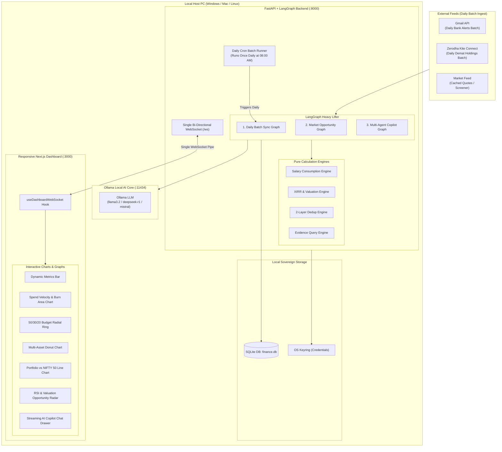
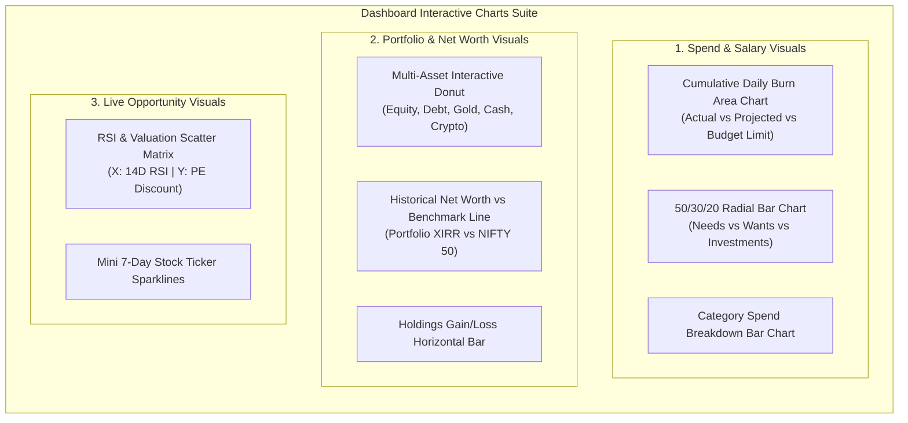
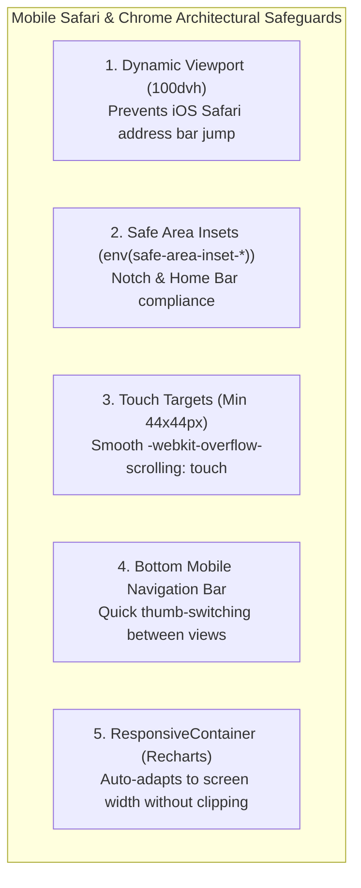

# Personal Finance & Investment AI Assistant — Complete Technical Architecture

> **Version**: 2.5 (Rich Charts + Mobile-Responsive WebSocket Edition) · **Date**: 2026-08-15  
> **Status**: Architecture Specification — Ready for Implementation  
> **Core Engine**: Local Ollama LLM (`llama3.2`) + Multi-Agent LangGraph Workflows  
> **Visuals**: Rich Interactive Charts & Graphs (Recharts / Lightweight Visuals)  
> **Form Factor**: Fully Mobile-Responsive (iOS Safari & Android Chrome Optimized)  
> **Interface**: Single Bi-directional WebSocket Pipe (`ws://localhost:8000/ws`) + Plain & Simple Dashboard  

---

## Table of Contents

1. [System Overview & Visual Philosophy](#1-system-overview--visual-philosophy)
2. [Binding Architectural Principles](#2-binding-architectural-principles)
3. [System Topology & Local Execution Architecture](#3-system-topology--local-execution-architecture)
4. [Rich Visualizations & Charting Architecture](#4-rich-visualizations--charting-architecture)
5. [Mobile-First Responsive Design (iOS Safari & Chrome)](#5-mobile-first-responsive-design-ios-safari--chrome)
6. [Ollama Local AI Financial Intelligence Engines](#6-ollama-local-ai-financial-intelligence-engines)
7. [LangGraph Heavy Lifter & Daily Batch Sync](#7-langgraph-heavy-lifter--daily-batch-sync)
8. [Single WebSocket Pipe Protocol Specification](#8-single-websocket-pipe-protocol-specification)
9. [Data Architecture & SQLite Database Schema](#9-data-architecture--sqlite-database-schema)
10. [Two-Layer Deduplication & Evidence System](#10-two-layer-deduplication--evidence-system)
11. [Directory Structure](#11-directory-structure)
12. [Local Development & Native Run Workflow](#12-local-development--native-run-workflow)

---

## 1. System Overview & Visual Philosophy

The **Personal Finance & Investment AI Assistant** is a local-first, privacy-sovereign financial copilot designed to transform raw financial numbers into rich, interactive visual intelligence. It replaces dry text tables with dynamic charts, spending velocity curves, asset allocation rings, and RSI opportunity heatmaps.

### Key Architectural Pillars:
1. **Interactive Visual Dashboard**: Rich charts (Area, Donut, Multi-line Benchmark, Sparklines, and RSI Scatter Radar) powered by Recharts.
2. **Mobile-First Responsiveness (iOS Safari + Chrome)**: Built with dynamic viewport heights (`100dvh`), iOS safe area insets (`env(safe-area-inset-*)`), smooth WebKit touch gestures, and a segmented mobile tab bar.
3. **100% Local AI via Ollama**: Runs locally on your host PC (`http://localhost:11434`) using `llama3.2` or `deepseek-r1` for zero data leakage.
4. **Daily Once Batch Sync**: Gmail and Zerodha sync run strictly as a daily batch job (or manual `[⚡ Sync Now]`), eliminating continuous polling and conserving API quotas.
5. **Single Bi-Directional WebSocket Pipe**: All data, chart states, market ticks, and streaming AI reasoning flow over a single connection (`/ws`).
6. **Native Local Execution**: Zero Docker required for development.

---

## 2. Binding Architectural Principles

```
┌─────────────────────────────────────────────────────────────────────────┐
│                     BINDING ARCHITECTURAL PRINCIPLES                     │
├─────────────────────────────────────────────────────────────────────────┤
│  P1. Visual-First Intelligence  │  All financial metrics are visual-    │
│                                 │  ized with interactive charts/graphs. │
├─────────────────────────────────┼───────────────────────────────────────┤
│  P2. Mobile Safari & Chrome     │  Flawless responsive UI with safe area│
│      Optimized                  │  insets and 100dvh touch layout.      │
├─────────────────────────────────┼───────────────────────────────────────┤
│  P3. Local-First Sovereignty    │  100% of data and Ollama AI inference │
│                                 │  remains strictly on your local PC.   │
├─────────────────────────────────┼───────────────────────────────────────┤
│  P4. Daily Batch Ingestion      │  Gmail & Zerodha sync once daily      │
│      (No Polling)               │  with on-demand manual override.      │
├─────────────────────────────────┼───────────────────────────────────────┤
│  P5. Single WebSocket Pipe      │  Zero REST API sprawl. The dashboard   │
│                                 │  communicates entirely over /ws.      │
├─────────────────────────────────┼───────────────────────────────────────┤
│  P6. Verifiable Evidence Trail  │  Every LLM claim links to a trace-   │
│                                 │  able, re-executable query evidence.  │
└─────────────────────────────────────────────────────────────────────────┘
```

---

## 3. System Topology & Local Execution Architecture



---

## 4. Rich Visualizations & Charting Architecture

The dashboard provides visual clarity across all four financial dimensions using **Recharts**:



### 1. Cumulative Salary Burn & Velocity Area Chart
- **Visual**: Smooth stacked gradient area chart.
- **Data Series**:
  - `Baseline Salary Level` (Horizontal reference line).
  - `Cumulative Actual Spends` (Solid purple/blue gradient area).
  - `Projected Month-End Spend Curve` (Dotted trajectory line).
  - `Safe Spending Velocity Channel` (Green shaded corridor).

### 2. 50/30/20 Financial Wellness Radial Ring
- **Visual**: Nested multi-ring radial progress chart.
- **Rings**: Needs (Target: 50%), Wants (Target: 30%), Investments (Target: 20%).
- **Interaction**: Hover/tap displays exact rupee totals and percentage compliance.

### 3. Multi-Asset Allocation Donut with Target Overlay
- **Visual**: Double-ring concentric donut chart.
  - Inner Ring: Actual asset breakdown (Equity, Debt, Gold, Liquid Cash).
  - Outer Ring: Target model allocation.
- **Rebalancing Highlighting**: Slices highlight in amber/red when asset class deviates > 3% from target.

### 4. Portfolio Performance vs NIFTY 50 Benchmark Line Chart
- **Visual**: Synchronized multi-line time series chart comparing portfolio total returns against the NIFTY 50 / S&P 500 index.

### 5. RSI & Valuation Opportunity Matrix
- **Visual**: Interactive 2D Scatter plot.
  - X-Axis: 14-Day RSI (Oversold zone < 35 highlighted in green).
  - Y-Axis: PE Ratio Discount vs 3-Year Historical Average.
  - Bubble Size: Market Cap / User Surplus Match.

---

## 5. Mobile-First Responsive Design (iOS Safari & Chrome)

The UI is engineered from the ground up for seamless touch interaction on both **iOS Safari** and **Android Chrome**:



### Mobile Layout Structure (Phone Viewport: 390px - 430px)

```
┌────────────────────────────────────────────────────────┐
│ [● Connected]   FINANCE AI ASSISTANT   [⚡ Sync Now]   │
├────────────────────────────────────────────────────────┤
│ NET WORTH             LIQUID CASH       XIRR (ANNUAL)  │
│ ₹42,50,000 ▲ +1.8%     ₹3,20,000         +18.4% p.a.    │
├────────────────────────────────────────────────────────┤
│ [ Spends ]  [ Asset Allocation ]  [ Radar ]  [ AI Chat]│ <- Segmented Tab
├────────────────────────────────────────────────────────┤
│                                                        │
│  SALARY CONSUMPTION & BURN VELOCITY                    │
│  ┌──────────────────────────────────────────────────┐  │
│  │     /\                                           │  │
│  │    /  \__  Actual: ₹68k / Projected: ₹84k        │  │
│  │   /      \________________________ (Budget 85k)  │  │
│  └──────────────────────────────────────────────────┘  │
│                                                        │
│  50/30/20 HEALTH: Needs 48% | Wants 28% | Invest 24%   │
│  • Fixed Bills: ₹38,000   • Dining/Shop: ₹30,000       │
│                                                        │
├────────────────────────────────────────────────────────┤
│  OPPORTUNITY RADAR (2 Active Signals)                  │
│  • INFY: RSI 31 (Oversold Dip) - Target ₹1,650 [Buy]   │
│  • Tata Motors: 200 EMA Support - ₹982 (+1.4%)         │
├────────────────────────────────────────────────────────┤
│  AI COPILOT QUICK PROMPT:                              │
│  [ "Can I invest ₹25k in INFY with this month's cash?" ]│
│  [ Ask anything...                                   ▲]│
├────────────────────────────────────────────────────────┤
│   [📊 Overview]   [💳 Spends]   [📈 Wealth]   [🤖 Chat] │ <- Bottom Safe Bar
└────────────────────────────────────────────────────────┘
```

### Specific iOS Safari & Chrome CSS Rules:
- **`min-height: 100dvh`**: Replaces `100vh` to eliminate content jumping when Safari's URL bar collapses/expands.
- **`padding-bottom: calc(1rem + env(safe-area-inset-bottom))`**: Ensures bottom navigation buttons never overlap the iPhone home indicator bar.
- **`touch-action: manipulation`**: Removes the 300ms double-tap delay on mobile Safari.
- **Responsive Chart Aspect Ratios**: Mobile switches from fixed height to fluid aspect ratio containers (`aspect-[4/3]` or `aspect-[16/9]`).

---

## 6. Ollama Local AI Financial Intelligence Engines

Structured data from SQLite and the live market cache are fed directly into local Ollama (`http://localhost:11434`):
1. **Spend Analysis & Salary Consumption**: Evaluates inflow vs burn, 50/30/20 budget adherence, and subscription leaks.
2. **Portfolio Performance & Risk Engine**: Calculates true annualized XIRR, sector drag, and asset allocation imbalances.
3. **Data-Driven Stock Suggestions**: Generates surplus-aware investment theses matching liquid cash with technical pullbacks (14-day RSI < 35) and PE discounts.

---

## 7. LangGraph Heavy Lifter & Daily Batch Sync

- **Daily Batch Sync (Once Daily at 08:00 AM)**: Pulls past 24h Gmail alerts and Zerodha Demat holdings in a single batch, eliminating continuous polling.
- **On-Demand Manual Sync**: `[⚡ Sync Now]` button on the dashboard triggers an immediate batch run anytime.
- **2-Layer Deduplication**: Layer 1 checks Gmail `provider_message_id`, Layer 2 checks `SHA256(amount + date + normalized_merchant + account_id)`.

---

## 8. Single WebSocket Pipe Protocol Specification

All client-server communications happen over `ws://localhost:8000/ws`.

### A. Client → Server Messages
| Action Type | Payload Example | Description |
|---|---|---|
| `INIT_DASHBOARD` | `{}` | Requests full initial snapshot of dashboard data on connect. |
| `TRIGGER_SYNC` | `{ "provider": "all" }` | Initiates manual on-demand batch sync. |
| `SEND_CHAT` | `{ "session_id": "...", "content": "..." }` | Sends prompt to local Ollama copilot. |
| `ADD_WATCHLIST_TICKER` | `{ "symbol": "INFY", "target_price": 1600 }` | Adds ticker to automated opportunity scanner. |

### B. Server → Client Events
| Event Type | Payload Data | Dashboard Target |
|---|---|---|
| `DASHBOARD_SNAPSHOT` | Full state: `{ net_worth, salary_burn_series, allocation_data, opportunities, recent_txns }` | Hydrates all charts and metric cards on initial load. |
| `SYNC_STATUS` | `{ step: "parsing_emails", items_found: 12, txns_staged: 4, last_sync: "08:00 AM" }` | Updates sync indicator badge. |
| `MARKET_TICK` | `{ symbol: "RELIANCE", price: 2980.50, change_pct: +1.2 }` | Live updates ticker prices and radar scatter. |
| `OPPORTUNITY_ALERT` | `{ symbol: "INFY", type: "rsi_oversold", thesis: "..." }` | Pushes new stock card into radar view. |
| `CHAT_TOKEN` | `{ token: "You ", is_final: false }` | Streams Ollama response tokens into chat drawer. |
| `CHAT_COMPLETE` | `{ full_text: "...", evidence_id: "ev_8f2", summary: {...} }` | Finalizes AI chat response with evidence tag. |

---

## 9. Data Architecture & SQLite Database Schema

The database uses SQLite (`finance.db`) for lightweight, sovereign local execution:
- **Ledger & Ingestion**: `accounts`, `categories`, `merchants`, `transactions`, `staged_transactions`, `sync_runs`, `email_sources`, `transaction_fingerprint_sources`.
- **Planning & Goals**: `budgets`, `goals`.
- **Portfolio & Market**: `portfolio_holdings`, `market_price_cache`, `watchlists`, `watchlist_items`, `investment_opportunities`.
- **Verifiable AI Evidence**: `advisor_sessions`, `evidence_queries`, `fin_audit_logs`.

---

## 10. Two-Layer Deduplication & Evidence System

- **Layer 1 (Email Message Dedup)**: Checks Gmail `provider_message_id`.
- **Layer 2 (Financial Event Dedup)**: Computes `SHA256(amount + date + normalized_merchant + account_id)`.
- **Verifiable Evidence Engine**: Ollama answers never hallucinate numbers. Every analytical figure links to a parameterized SQL query stored with an `evidence_id`, allowing instant re-execution and mathematical verification.

---

## 11. Directory Structure

```
ai_finance_assistant/
├── backend/
│   ├── src/
│   │   ├── __init__.py
│   │   ├── main.py                  # FastAPI + WebSocket endpoint
│   │   ├── config.py                # Ollama & app settings
│   │   ├── database.py              # SQLite engine & session maker
│   │   ├── models/                  # SQLAlchemy ORM models
│   │   ├── schemas/                 # Pydantic schemas & WS event types
│   │   ├── repositories/            # Data access queries
│   │   ├── services/                # Pure calculation engines
│   │   │   ├── fingerprint.py       # 2-layer dedup
│   │   │   ├── budget_engine.py     # Salary consumption & burn rate
│   │   │   ├── portfolio_engine.py  # Valuation, XIRR, allocation
│   │   │   └── market_service.py    # Cached market data & screener
│   │   ├── integrations/            # Gmail, Zerodha, Keyring, Ollama client
│   │   └── ai/                      # LangGraph Heavy Lifter
│   │       ├── state.py
│   │       ├── tools.py
│   │       ├── sync_graph.py        # Daily batch Gmail + Zerodha ingestion
│   │       ├── market_graph.py      # Opportunity scanner workflow
│   │       └── copilot_graph.py     # Multi-agent Ollama copilot
│   └── requirements.txt
├── frontend/
│   ├── src/
│   │   ├── app/
│   │   │   ├── layout.tsx           # Mobile viewport & safe-area wrapper
│   │   │   └── page.tsx             # Responsive Unified Dashboard
│   │   ├── components/
│   │   │   ├── dashboard/
│   │   │   │   ├── MetricsHero.tsx  # Dynamic KPI cards
│   │   │   │   ├── SpendVelocityChart.tsx # Cumulative burn area chart
│   │   │   │   ├── BudgetRadialRing.tsx   # 50/30/20 radial progress
│   │   │   │   ├── AssetAllocationDonut.tsx # Interactive donut chart
│   │   │   │   ├── BenchmarkPerformanceLine.tsx # Portfolio vs NIFTY 50
│   │   │   │   ├── OpportunityScatterRadar.tsx  # RSI & valuation matrix
│   │   │   │   ├── CopilotChatDrawer.tsx        # Responsive chat drawer
│   │   │   │   └── MobileBottomNav.tsx          # Mobile thumb navigation
│   │   │   └── ui/
│   │   ├── hooks/
│   │   │   └── useDashboardWebSocket.ts
│   │   └── lib/
│   │       └── types.ts
│   ├── package.json
│   └── tailwind.config.js
├── .env.example
└── README.md
```

---

## 12. Local Development & Native Run Workflow

### Terminal 1: Ollama Server
```bash
ollama run llama3.2
# Ollama serving on http://localhost:11434
```

### Terminal 2: Backend
```bash
cd backend
python -m venv .venv
.venv\Scripts\activate
pip install -r requirements.txt
python src/main.py
# Backend active on ws://localhost:8000/ws
```

### Terminal 3: Frontend
```bash
cd frontend
npm install
npm run dev
# Dashboard active on http://localhost:3000 (Tested on Mobile Safari & Chrome)
```
